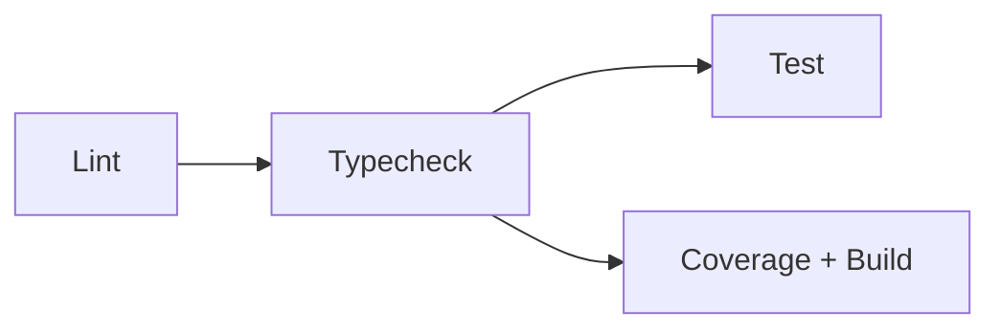

# GitHub Actions CI/CD

Este diretório contém a configuração do CI/CD do projeto usando GitHub Actions.

## 📋 Workflows

### `ci.yml` - Continuous Integration

Pipeline principal que executa em todos os PRs e pushs para `main`:

- **Lint** - Verifica código com ESLint
- **Typecheck** - Valida tipos TypeScript
- **Test** - Roda testes unitários (Node 18 e 20)
- **Coverage** - Gera relatório de cobertura e build de produção

## 🔐 Configuração de Secrets

**⚠️ IMPORTANTE:** Este projeto requer secrets configurados no GitHub para funcionar corretamente.

### Secrets Obrigatórios

| Secret                   | Descrição                 | Onde Obter                                                                        |
| ------------------------ | ------------------------- | --------------------------------------------------------------------------------- |
| `VITE_SUPABASE_URL`      | URL do projeto Supabase   | [Supabase Dashboard](https://app.supabase.com) → Settings → API → Project URL     |
| `VITE_SUPABASE_ANON_KEY` | Chave pública do Supabase | [Supabase Dashboard](https://app.supabase.com) → Settings → API → anon/public key |

### Secrets Opcionais

| Secret             | Descrição                        | Onde Obter                                                    |
| ------------------ | -------------------------------- | ------------------------------------------------------------- |
| `VITE_SENTRY_DSN`  | DSN do Sentry para monitoramento | [Sentry.io](https://sentry.io) → Settings → Client Keys (DSN) |
| `VITE_APP_VERSION` | Versão da aplicação              | Definir manualmente (ex: `1.0.0`)                             |

### Como Configurar

**Opção 1: Via Interface do GitHub (Recomendado)**

1. Vá para **Settings** do repositório
2. Clique em **Secrets and variables** → **Actions**
3. Clique em **New repository secret**
4. Adicione cada secret com nome e valor

**Opção 2: Via GitHub CLI**

```bash
# Instale o gh CLI: https://cli.github.com/
gh secret set VITE_SUPABASE_URL
gh secret set VITE_SUPABASE_ANON_KEY
gh secret set VITE_SENTRY_DSN
gh secret set VITE_APP_VERSION
```

### 📖 Documentação Detalhada

Para instruções completas, consulte: [SECRETS_SETUP.md](./SECRETS_SETUP.md)

## 🚀 Como Funciona

### Valores Fallback

Se os secrets **não estiverem configurados**, o workflow usará valores fallback:

- `VITE_SUPABASE_URL`: `http://localhost:54321`
- `VITE_SUPABASE_ANON_KEY`: `dummy-key-for-ci`

Isso permite que lint e typecheck rodem, mas **não é adequado para produção**.

### Status dos Jobs



Todos os jobs precisam passar para o PR ser aprovado.

## 📊 Artefatos

O workflow gera e faz upload dos seguintes artefatos:

- **Coverage** (`coverage-{sha}`) - Relatório de cobertura de testes (7 dias)
- **Build** (`dist-{sha}`) - Build de produção (7 dias)

Para baixar artefatos:

1. Vá na aba **Actions**
2. Clique no workflow executado
3. Role até **Artifacts** e faça download

## 🔧 Troubleshooting

### ❌ Erro: "Missing secret: VITE_SUPABASE_URL"

**Causa:** Secrets não configurados no repositório.

**Solução:**

1. Configure os secrets conforme documentação acima
2. Re-rode o workflow

### ❌ Workflow falha mesmo com secrets configurados

**Verificações:**

- [ ] Nome do secret está correto? (case-sensitive)
- [ ] Valor não tem espaços extras?
- [ ] Secret foi salvo corretamente?

**Solução:**

1. Vá em Settings → Secrets
2. Verifique os valores
3. Atualize se necessário
4. Re-rode o workflow

### ⚠️ Warning: "Using fallback value for CI"

**Causa:** Secret não está configurado.

**Impacto:** Workflow pode rodar mas usar valores dummy.

**Solução:** Configure os secrets para valores reais.

## 🔒 Segurança

- ✅ Secrets são criptografados pelo GitHub
- ✅ Secrets não aparecem em logs
- ✅ Apenas branches protegidos têm acesso
- ❌ Nunca commite secrets no código
- ❌ Nunca logue valores de secrets

## 📚 Links Úteis

- [GitHub Actions Documentation](https://docs.github.com/en/actions)
- [Encrypted Secrets](https://docs.github.com/en/actions/security-guides/encrypted-secrets)
- [Workflow Syntax](https://docs.github.com/en/actions/using-workflows/workflow-syntax-for-github-actions)
- [Supabase Documentation](https://supabase.com/docs)
- [Sentry Documentation](https://docs.sentry.io/)
